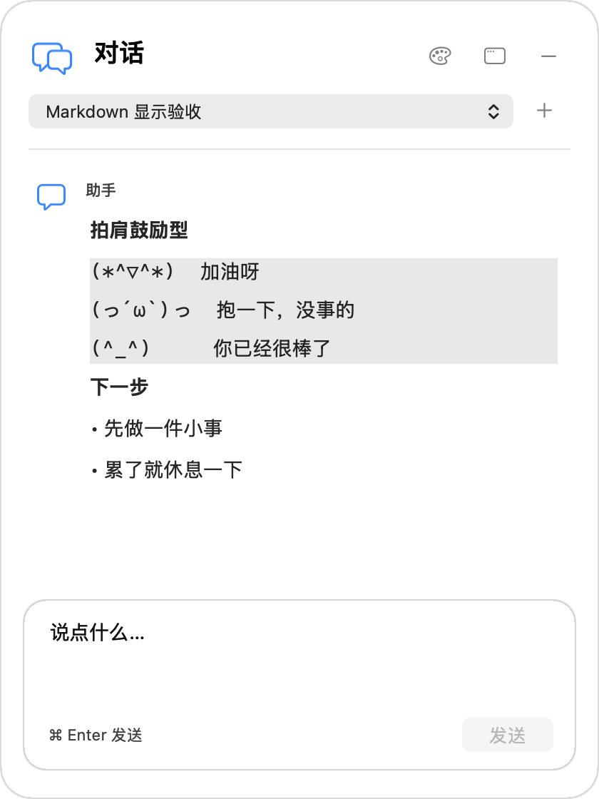
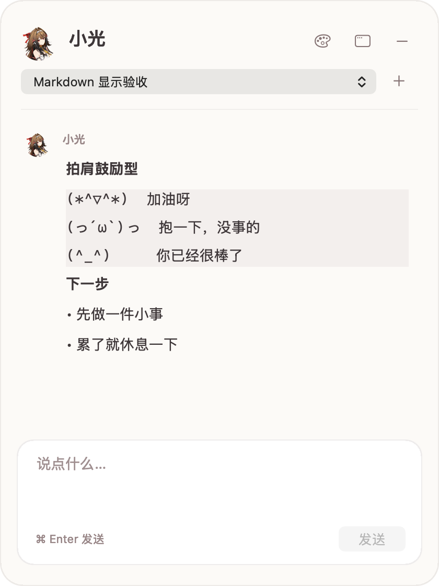

# lookover · 在当前页面提问，把解决经验留给下次

你正在读文档、看网页或排查报错，问题就出现在眼前。三个可独立安装的 DSH 插件组合起来：**气泡让你少切页面，Look 让你少贴背景，经验记忆让你少重复解释。**

| 插件 | 解决的摩擦 | 与其他插件怎么配合 |
| --- | --- | --- |
| [dsh-bubble · 悬浮对话](dsh-bubble/) | 为问一句话切到完整聊天窗口 | 在工作页面旁提问、查看回复；需要设置或授权时回到 DSH 主窗口 |
| [dsh-look · 页面上下文](dsh-look/) | 每次都复制文字、描述页面或上传截图 | 在问题依赖屏幕内容时按需读取窗口，给气泡对话提供真实上下文 |
| [dsh-expmem · 解决经验](dsh-expmem/) | 下次遇到相似问题又从头解释 | 保存问题、做法、来源和适用条件，供后续检索、纠正或删除 |

建议先装 **气泡 + Look**，体验当前页面旁的问答；有值得复用的经验后，再加入经验记忆。三个插件都能独立使用，不会互相强制安装。

## 第一次可以这样试

1. 在浏览器或编辑器中把目标页面放到最前，选中想问的文字。
2. 点开气泡，输入：**“请用 look 看一下浏览器里这段选中文字，帮我解释。”**
3. 回复出现在气泡里。能读到多少取决于权限和目标应用；读不到时应明确告知，你也可以直接粘贴文字。
4. 问题解决并确认结果后，说：**“把这次问题、解决方法和适用条件保存为经验，只记录已经确认的结果。”**
5. 下次遇到相似问题，说：**“先检索之前相关的经验，再判断这次是否适用。”** 本次约束变了，就需要重新判断。

这是推荐的组合流程。读取、保存、召回依赖宿主 Agent 正确调用工具；不是自动操作其他应用或全自动长期记忆。模型和其他工具仍由 DSH 提供。

## 下载与安装

三个插件已发布到 npm：[dsh-bubble@0.3.5](https://www.npmjs.com/package/dsh-bubble)、[dsh-look@0.1.1](https://www.npmjs.com/package/dsh-look)、[dsh-expmem@0.1.1](https://www.npmjs.com/package/dsh-expmem)。包内附预编译组件，无需本机编译 Swift；[GitHub Release](https://github.com/mengxiaoxian/lookover/releases/tag/lookover-2026.10.12) 保留相同版本包与 SHA256 校验清单作为备用。

**当前组合目标：macOS Apple Silicon（arm64）＋官方 DeepSeek Harness 0.2.0-rc.2 桌面版。** 其他系统、Intel Mac 和后续宿主版本尚未完成这套组合的验收；包内声明此次宿主版本。

关闭 DSH 后，在终端运行，再正常打开官方应用：

```sh
# 先体验气泡与页面上下文
dsh plugin --profile desktop add dsh-bubble@0.3.5 dsh-look@0.1.1
# 需要保存与复用经验时再安装
dsh plugin --profile desktop add dsh-expmem@0.1.1
```

没有 `dsh` 命令时，把命令开头的 `dsh` 替换为官方内置 CLI：

```sh
"/Applications/DeepSeek Harness.app/Contents/Resources/runtime/cli/bin/dsh"
```

只想体验一个插件，就只保留对应包名。气泡的市场收录及三张卡片的新说明仍在[草稿 PR #7207](https://github.com/awesome-dsh-plugin/awesome-dsh-plugin/pull/7207)，尚未合并。npm 包发布不等于市场卡片文案已更新；市场目录的版本同步也可能滞后，以 npm 上的公开版本和本文为准。

已装本地 `dsh-xiaoguang-companion-proof` 的用户，请先停用旧气泡插件，再装 `dsh-bubble`，避免双开；无需删除会话历史。新用户直接安装。

## 权限与边界

- 气泡本身不读取屏幕，不要求辅助功能或屏幕录制权限。工具授权、附件、模型设置和复杂内容仍回主窗口处理。
- Look 无权限时只有应用与窗口基本信息；“辅助功能”权限用于标题、选区等应用暴露的文本；“屏幕录制”用于按需截图及本地 OCR（文字识别）。按实际需要在系统设置中授权给对应 DSH 应用。
- 本版通过点击气泡使用，不提供旧小光壳的召唤热键，不承诺按键瞬间保存选区。选区可能因失焦消失，失败时可粘贴文本。
- Look 按需读取，不持续监视。OCR 在本机完成，但读取结果提供给当前 Agent；使用云端模型时，相关上下文随对话发送给所选模型。读取日志在 `~/.dsh/look/log.jsonl`，可能包含窗口文本。
- 经验默认存于 `$DSH_HOME/mem`（未设置时为 `~/.dsh/mem`），没有云端同步。词元检索可能漏掉同义改写，不适合多进程共写一个目录。删除当前案例不等于安全擦除追加日志。
- 原生助手带本地临时签名，尚无 Apple 开发者签名与公证；跨机器首次启动是否被系统拦截仍需验证。

## 气泡预览




外观切换不改变会话或任务。截图来自独立验收对话。

## 开发与验证

- [气泡使用与开发说明](dsh-bubble/README.md)
- [Look 使用说明](dsh-look/README.md)
- [经验记忆使用说明](dsh-expmem/README.md)
- [本轮发布与验证范围](docs/release-2026-10-12.md)
- [早期验收](docs/acceptance-M0.md)与[工程记录](docs/engineering-handoff-2026-09-20.md)保留原日期，其中旧壳的热键、语音和原型能力不等于此次发行承诺。

MIT License。基于 DeepSeek Harness 插件机制，由社区作者维护。
